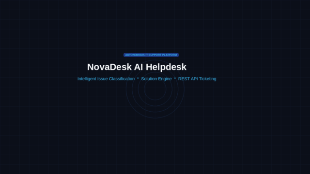

# HelpDesk Support Platform — Enterprise IT Service Management



An enterprise IT HelpDesk service management platform built with FastAPI, Streamlit, LangChain, Groq, and SQLite.

The platform automates IT support request classification, calculates ITIL-compliant SLA priorities, generates step-by-step diagnostic workflows with copyable terminal commands, matches internal knowledge base runbooks, and provides complete ticket lifecycle management via REST APIs and an operations dashboard. Full documentation is available in [DOCUMENTATION.pdf](DOCUMENTATION.pdf).

---

## Key Features

1. **Automated Issue Classification & SLA Prioritization**:
   - **ITIL Category Mapping**: Automatically classifies inquiries into *Hardware*, *Software*, *Network & Connectivity*, *Identity & Access (IAM)*, *Security & Compliance*, *Email & Collaboration*, *Cloud & Infrastructure*, and more.
   - **Calculated Priorities**: Assigns **P1 Critical** (1h SLA), **P2 High** (4h SLA), **P3 Medium** (24h SLA), or **P4 Low** (48h SLA) based on calculated urgency and impact.
   - **Target Queue Routing**: Routes requests to designated resolver teams (*NetOps*, *SecOps*, *IAM*, *DevOps*, *Workstation Support*).

2. **Actionable Diagnostic Procedures**:
   - Generates sequential troubleshooting workflows tailored to the reported operating environment.
   - Provides verified terminal, PowerShell, or bash commands (e.g., `ipconfig /flushdns`, `manage-bde -status`, `taskkill /F /IM outlook.exe`).
   - Assesses whether an issue is self-resolvable or requires on-site technician escalation.

3. **Complete Ticket Management REST APIs**:
   - Create tickets with automated or custom diagnostics (`POST /api/tickets`).
   - Query tickets with real-time text search, status filters, priority filters, and pagination (`GET /api/tickets`).
   - Detailed ticket timeline and internal technician work notes thread (`POST /api/tickets/{id}/comments`).
   - Ticket resolution lifecycle with root-cause logging (`POST /api/tickets/{id}/resolve`).
   - Interactive OpenAPI documentation at `/docs`.

4. **Interactive Support Assistant & Live Diagnostics**:
   - Real-time technician chat interface with live diagnostic extraction.
   - Incident diagnosis card updates dynamically as details are provided.
   - One-click ticket creation directly from diagnostics.

5. **Knowledge Base & Standard Operating Procedures**:
   - Searchable library of standard operating procedures (SOPs) covering VPN gateways, MFA desync, BitLocker recovery, Outlook cache corruption, Docker socket errors, and docking station configurations.

6. **Operational SLA & Health Analytics**:
   - Real-time tracking of active queues, critical SLA deadlines, resolution throughput, and incident category distributions.

---

## Architecture & Technology Stack

```
IT Helpdesk Agent/
├── app/
│   ├── __init__.py
│   ├── config.py             # Settings, environment variables, Pydantic configuration
│   ├── database.py           # SQLite repository, schema migrations, and seed data
│   ├── models.py             # Pydantic schemas for tickets, triage, chat, KB, and metrics
│   ├── agent.py              # LLM diagnosis engine using Groq gpt-oss-120b with heuristic fallbacks
│   ├── routes/
│   │   ├── __init__.py
│   │   ├── triage.py         # Triage and classification endpoints (/api/triage)
│   │   ├── tickets.py        # Ticket CRUD and lifecycle endpoints (/api/tickets)
│   │   ├── agent_chat.py     # Interactive support console (/api/agent/chat)
│   │   ├── kb.py             # Knowledge Base API (/api/kb)
│   │   └── stats.py          # Operational metrics & SLA compliance (/api/stats)
│   └── main.py               # FastAPI application entry point and static file server
├── static/
│   ├── css/
│   │   └── style.css         # Dashboard styles and animations
│   ├── js/
│   │   └── app.js            # Frontend application controller
│   └── index.html            # HelpDesk dashboard interface
├── tests/
│   ├── test_agent.py         # Diagnosis and fallback test suite
│   ├── test_tickets_api.py   # Ticket management API test suite
│   └── test_triage_api.py    # Triage, KB, and analytics test suite
├── streamlit_app.py          # HelpDesk Command Center dashboard
├── DOCUMENTATION.pdf         # Complete project documentation and architecture manual
├── run.py                    # Server startup script
├── .env                      # Environment configuration
└── requirements.txt          # Project dependencies
```

- **Backend**: FastAPI, Uvicorn, Pydantic v2
- **Language Models**: LangChain (`langchain-groq`), Groq API (`openai/gpt-oss-120b` with automatic fallback to `openai/gpt-oss-20b` and deterministic heuristic engine)
- **Database**: SQLite with thread-safe connection pooling
- **Frontend & Interfaces**: Streamlit Command Center, HTML5 / TailwindCSS / Lucide Icons Web Console
- **Testing**: Pytest & HTTPX TestClient

---

## Quickstart Guide

### 1. Environment Setup

Ensure Python 3.10+ is installed:

```bash
# Clone the repository
git clone https://github.com/kcrimson-star/it-helpdesk-agent.git
cd it-helpdesk-agent

# Create and activate virtual environment
python3 -m venv .venv
source .venv/bin/activate

# Install dependencies
pip install -r requirements.txt
```

### 2. Configure Environment Variables

Create or configure `.env`:

```env
GROQ_API_KEY="your-groq-api-key"
GROQ_MODEL="openai/gpt-oss-120b"
GROQ_FALLBACK_MODEL="openai/gpt-oss-20b"
APP_HOST="0.0.0.0"
APP_PORT=8000
DEBUG=True
```

### 3. Launch the Application

#### Option A: HelpDesk Command Center (Streamlit Dashboard)
```bash
streamlit run streamlit_app.py
```
Access at: `http://localhost:8501`

#### Option B: FastAPI Backend Service
```bash
python run.py
```
Or with Uvicorn:
```bash
uvicorn app.main:app --host 0.0.0.0 --port 8000 --reload
```
Access at:
- **Web Dashboard**: `http://localhost:8000`
- **Interactive OpenAPI Documentation**: `http://localhost:8000/docs`

---

## Running the Test Suite

Execute the pytest test suite:

```bash
PYTHONPATH=. pytest -v
```

All 9 test suites verify:
- Issue diagnosis and category assignment
- Priority calculation and SLA determination
- Ticket lifecycle operations (creation, filtering, comment addition, status patching, resolution)
- Knowledge Base search and statistical metrics

---

## REST API Reference

### 1. Classify and Triage an Issue
```bash
curl -X POST "http://localhost:8000/api/triage/classify" \
  -H "Content-Type: application/json" \
  -d '{
    "issue_description": "GlobalProtect VPN timeout error 502 while connecting",
    "requester_name": "Sarah Connor",
    "system_info": "macOS Sonoma 14.5"
  }'
```

### 2. Create a Ticket with Automated Diagnostics
```bash
curl -X POST "http://localhost:8000/api/tickets" \
  -H "Content-Type: application/json" \
  -d '{
    "description": "Lenovo laptop blue screens with BitLocker prompt after BIOS update",
    "requester_name": "Marcus Vance",
    "requester_email": "m.vance@company.corp",
    "department": "Finance",
    "auto_diagnose": true
  }'
```

### 3. List Tickets with Filters
```bash
curl -X GET "http://localhost:8000/api/tickets?status=Open&priority=Critical"
```

### 4. Interactive Chat
```bash
curl -X POST "http://localhost:8000/api/agent/chat" \
  -H "Content-Type: application/json" \
  -d '{
    "message": "My Outlook calendar is refusing to sync new invites",
    "history": []
  }'
```

### 5. Resolve Ticket
```bash
curl -X POST "http://localhost:8000/api/tickets/1041/resolve?resolution_notes=Reconfigured+failover+BGP+gateway+route"
```

---

## Documentation

Full architectural specifications, data models, and API schemas are compiled in [DOCUMENTATION.pdf](DOCUMENTATION.pdf).
